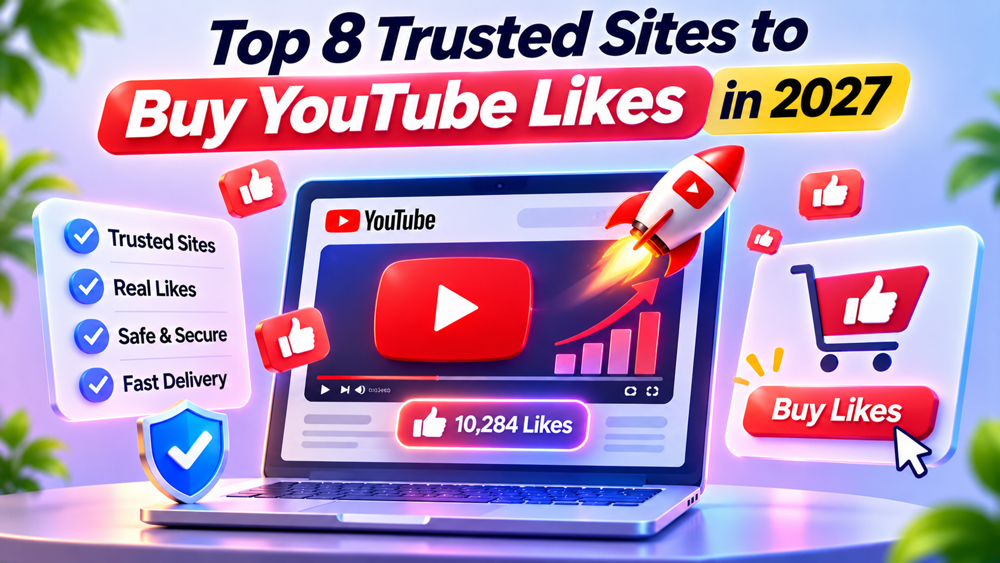

# Top 8 Trusted Sites to Buy YouTube Likes in 2027

[Explore useful YouTube growth resources](https://www.yttags.com/) and discover ways to improve your channel's engagement. Likes can help create a positive impression and make your videos more appealing to viewers.

In 2027, many creators are exploring different websites to buy YouTube likes and increase their social proof. Choosing a reliable platform is important for avoiding poor-quality services.

With so many options available, comparing pricing, features, delivery speed, and customer support can help you find a suitable provider.

In this article, we'll explore 8 trusted sites to buy YouTube likes in 2027 and compare their key features. You can also read our guide on [the best sites to buy YouTube views](https://www.yttags.com/best-sites-to-buy-youtube-views) for more information.

## Top 8 YouTube Likes Websites – Quick Comparison

| Website Name        | Service Type          | Order Options     | Support          |
| ------------------- | --------------------- | ----------------- | ---------------- |
| YoutubeStorm        | YouTube Likes         | Multiple Packages | Customer Support |
| My Social Following | Paid Likes            | Flexible Packages | Online Support   |
| SocialBoosting      | Paid Likes            | Multiple Packages | 24/7 Support     |
| Bulkoid             | YouTube Likes         | Multiple Packages | 24/7 Support     |
| YTpals              | Creator Promotion     | Free & Paid       | Online Support   |
| SoNuker             | Creator Promotion     | Free & Paid       | Online Support   |
| ViralHQ             | Social Promotion      | Custom Packages   | Customer Support |
| Media Mister        | Social Media Services | Multiple Packages | Customer Support |

*Note: Verify each provider's current services and support details before publishing. Purchased artificial engagement may violate YouTube's Fake Engagement Policy.*

## 1. YouTube Tags Extractor

Best For: Creators who want to find and extract relevant tags from YouTube videos.

The [YouTube Tags Extractor](https://www.yttags.com/youtube-tags-extractor) helps creators discover tags used in existing YouTube videos. It makes it easier to understand how other videos target specific keywords and organize their metadata. This tool can save time when researching competitors and planning video optimization.

Key Features:

- Extract tags from YouTube videos
- Analyze competitor tags
- Discover relevant keywords
- Copy extracted tags easily
- Simple and user-friendly interface

Pros and Cons

| Pros                      | Cons                            |
| ------------------------- | ------------------------------- |
| Easy to use               | Requires a video URL            |
| Saves research time       | Extracted tags need review      |
| Helps competitor research | Does not guarantee rankings     |
| Quick tag extraction      | Limited to available video data |

Pricing:

- Basic tag extraction: Check availability.
- Additional features: Check current tool options.
- No pricing claim without verification.

Review:

YouTube Tags Extractor is useful for creators who want to research video tags without checking them manually. It can make competitor analysis easier and help generate ideas for video optimization. However, extracted tags should always be reviewed for relevance before using them.

## 2. YouTube Tags Generator

Best For: YouTubers looking for relevant tags for their video topics.

The [YouTube Tags Generator](https://www.yttags.com/youtube-tags-generator) helps creators find suitable tags based on their video topics or keywords. It can simplify the process of preparing video metadata and discovering related search terms. Beginners and experienced creators can use it to organize their SEO efforts.

Key Features:

- Generate relevant YouTube tags
- Discover related keywords
- Simplify video optimization
- Save time during keyword research
- Easy-to-use interface

Pros and Cons

| Pros                   | Cons                      |
| ---------------------- | ------------------------- |
| Simple tag generation  | Suggestions need checking |
| Saves time             | Results may vary by topic |
| Beginner-friendly      | Not a ranking guarantee   |
| Helps keyword planning | Requires relevant input   |

Pricing:

- Tag generation: Check current availability.
- Additional options: Depends on available features.
- Verify pricing before use.

Review:

YouTube Tags Generator is a helpful option for creators who struggle to find relevant tags for their videos. It can provide keyword ideas and make metadata preparation easier. For better results, creators should select tags that accurately describe their content.

## 3. YouTube Keyword Generator Tools

Best For: Creators who want to discover keyword opportunities for YouTube videos.

The [YouTube Keyword Generator Tools guide](https://www.yttags.com/11-best-youtube-keyword-generator-tools) introduces different tools that can help creators research keywords for their content. Finding suitable keywords is an important part of YouTube SEO because it helps creators understand what audiences are searching for. Comparing multiple tools can make keyword research more effective.

Key Features:

- Discover keyword research tools
- Compare different options
- Find related search terms
- Support YouTube SEO planning
- Explore keyword opportunities

Pros and Cons

| Pros                          | Cons                   |
| ----------------------------- | ---------------------- |
| Multiple tools covered        | Requires comparison    |
| Useful for keyword research   | Some tools may be paid |
| Helps content planning        | Data can vary          |
| Beginner-friendly information | No guaranteed rankings |

Pricing:

- Guide access: Check current availability.
- Featured tools: Free and paid options may vary.
- Individual tool pricing depends on the provider.

Review:

This guide is useful for creators who want to explore different keyword research options in one place. It helps readers compare available tools and understand which features may suit their needs. It is a practical starting point for planning a YouTube SEO strategy.

## 4. YouTube Hashtags Extractor

Best For: Creators who want to find hashtags used in existing YouTube videos.

The [YouTube Hashtags Extractor](https://www.yttags.com/youtube-hashtags-extractor) helps users identify hashtags from YouTube video content. Hashtags can make videos easier to categorize and help viewers discover related content. This tool can simplify hashtag research and reduce the time spent checking videos manually.

Key Features:

- Extract YouTube hashtags
- Research competitor hashtags
- Discover relevant hashtag ideas
- Simplify content research
- Easy hashtag identification

Pros and Cons

| Pros                         | Cons                           |
| ---------------------------- | ------------------------------ |
| Saves research time          | Requires relevant video input  |
| Easy to understand           | Extracted hashtags need review |
| Supports competitor research | Not every hashtag is useful    |
| Simple workflow              | No guaranteed reach            |

Pricing:

- Basic extraction: Check availability.
- Additional features: Check current options.
- Pricing may vary if paid services are offered.

Review:

YouTube Hashtags Extractor can help creators understand how hashtags are used in existing videos. It is particularly useful when researching similar channels or planning content around a specific topic. Choosing relevant hashtags remains important for effective content organization.

## 5. YouTube Title Generator

Best For: YouTubers who need creative and engaging video title ideas.

The [YouTube Title Generator](https://www.yttags.com/youtube-title-generator) helps creators develop title ideas for their videos. Writing an attractive title can be challenging, especially when trying to balance creativity with relevant keywords. A title generator can provide inspiration and help creators explore different ways to present their content.

Key Features:

- Generate video title ideas
- Support keyword-based titles
- Explore creative suggestions
- Save brainstorming time
- Simplify title planning

Pros and Cons

| Pros                      | Cons                         |
| ------------------------- | ---------------------------- |
| Generates creative ideas  | Suggestions may need editing |
| Saves time                | Results depend on input      |
| Useful for beginners      | Titles need fact-checking    |
| Supports content planning | No guaranteed clicks         |

Pricing:

- Title generation: Check current availability.
- Additional features: Depends on available options.
- Verify any paid plans before purchasing.

Review:

YouTube Title Generator is a useful resource for creators who want fresh ideas for their video titles. It can help overcome writer's block and suggest different approaches to presenting content. Creators should personalize the generated titles to match their actual videos.

## 6. YouTube Video Ideas Generator

Best For: Creators who need fresh video topics and content inspiration.

The [YouTube Video Ideas Generator](https://www.yttags.com/youtube-video-ideas-generator) helps creators discover potential topics for their channels. Coming up with new content ideas regularly can be difficult, especially for creators who upload videos frequently. This tool can support brainstorming and help users explore different content directions.

Key Features:

- Generate video topic ideas
- Support content brainstorming
- Discover new content directions
- Save planning time
- Help maintain a content schedule

Pros and Cons

| Pros                          | Cons                               |
| ----------------------------- | ---------------------------------- |
| Encourages creativity         | Ideas may be broad                 |
| Helps overcome writer's block | Requires personal research         |
| Useful for planning           | Not every idea suits every channel |
| Saves brainstorming time      | Does not guarantee views           |

Pricing:

- Idea generation: Check current availability.
- Additional options: Check available features.
- Pricing details should be verified.

Review:

YouTube Video Ideas Generator can be helpful when creators run out of topics or want to try something new. It provides inspiration for future uploads and can make content planning easier. Reviewing each idea based on audience interests and channel niche can help improve its usefulness.

## 7. YouTube Hashtags Generator

Best For: Creators looking for relevant hashtags to organize and describe their videos.

The [YouTube Hashtags Generator guide](https://www.yttags.com/top-9-youtube-hashtags-generator) explores different hashtag generation options for YouTube creators. Using relevant hashtags can help communicate a video's topic and connect it with related content. Comparing available generators can help creators choose an option that matches their content research needs.

Key Features:

- Explore hashtag generator tools
- Discover relevant hashtag ideas
- Compare available options
- Support video optimization
- Simplify hashtag research

Pros and Cons

| Pros                        | Cons                       |
| --------------------------- | -------------------------- |
| Multiple options to explore | Requires tool comparison   |
| Helps discover hashtags     | Suggestions need checking  |
| Useful for content planning | Some options may be paid   |
| Beginner-friendly guide     | No guaranteed video growth |

Pricing:

- Guide access: Check current availability.
- Featured tools: Free and paid options may vary.
- Individual pricing depends on the selected tool.

Review:

This guide is useful for creators who want to explore different YouTube hashtag generators. It provides a starting point for comparing tools and discovering hashtag research options. Creators should focus on relevant hashtags instead of adding unrelated ones to their videos.

## 8. YouTube Channel Name Generator

Best For: New creators who want creative and memorable YouTube channel name ideas.

The [YouTube Channel Name Generator](https://www.yttags.com/youtube-channel-name-generator) helps aspiring creators explore possible names for their YouTube channels. Choosing the right name is an important early step because it contributes to channel identity and branding. This tool can provide inspiration and make the naming process easier for beginners.

Key Features:

- Generate channel name ideas
- Explore creative naming options
- Support channel branding
- Save brainstorming time
- Help new creators find inspiration

Pros and Cons

| Pros                     | Cons                           |
| ------------------------ | ------------------------------ |
| Useful for beginners     | Suggestions may be generic     |
| Helps generate ideas     | Names need availability checks |
| Saves brainstorming time | May require multiple attempts  |
| Supports branding        | No guarantee of uniqueness     |

Pricing:

- Name generation: Check current availability.
- Additional features: Check available options.
- Verify pricing before using paid services.

Review:

YouTube Channel Name Generator is a useful starting point for anyone planning to launch a new channel. It can provide creative suggestions and help creators explore different naming styles. Before finalizing a name, check its availability and make sure it matches your channel's niche and identity.

## Features to Look for in YouTube Likes Providers

Before choosing a YouTube likes provider, check its service details, pricing transparency, customer support, payment security, and refund policy. A reliable-looking website should clearly explain what it offers instead of making unrealistic promises.

YouTube SEO tools can also help creators improve their content strategy. For example, a [YouTube tags extractor](https://www.linkedin.com/pulse/7-best-youtube-tags-extractor-tools-2027-free-paid-darshit-bhanderi-bgjpf) can help identify relevant tags, while a [YouTube tags generator](https://www.linkedin.com/pulse/youtube-tags-generator-5-best-tools-boost-video-seo-darshit-bhanderi-hfvdf) can help creators find keywords related to their videos.

Important features to check:

- Transparent pricing and package details.
- Secure payment options.
- Clear delivery and refund policies.
- Responsive customer support.
- Genuine customer feedback.
- No unrealistic guarantees.
- Clear information about engagement quality.

You should also review independent information about content quality and originality. This [AI detector tools review](https://github.com/10-Best-AI-Detector-Tools-Honest-Review) may be useful when researching tools that evaluate AI-generated content.

## How Much Do YouTube Likes Cost?

The cost of YouTube likes varies depending on the provider, package size, delivery options, and claimed engagement quality. Small packages generally cost less than larger packages, but a higher price does not automatically guarantee better results.

Before purchasing, compare the available packages and read the provider's terms carefully. Also, remember that buying likes does not guarantee more views, subscribers, or improved rankings.

Your content strategy matters just as much as engagement. These resources can help with keyword research:

- Explore [YouTube keyword generator tools](https://www.linkedin.com/pulse/6-best-youtube-keyword-generator-tools-free-paid-darshit-bhanderi-a36jf) to find relevant search terms.
- Review [YouTube hashtags for more views](https://github.com/90-YouTube-Hashtags-for-More-Views) to understand how hashtags can support content discovery.
- Learn about [YouTube Shorts tags](https://www.linkedin.com/pulse/50-best-youtube-shorts-tags-get-more-views-2027-darshit-bhanderi-o7gaf) when optimizing short-form videos.

Factors that affect pricing:

- Number of likes in the package.
- Provider's pricing structure.
- Delivery options.
- Customer support availability.
- Refund and replacement policies.

Always check the latest price directly on the provider's website because rates and packages can change.

## Benefits of Buying YouTube Likes

Some creators consider buying YouTube likes to make a video appear more popular when it is first published. A higher visible like count may create social proof, but purchased engagement does not necessarily represent genuine audience interest.

Here are some commonly claimed benefits:

- Social proof: A higher like count may make a video appear more popular.
- Initial appearance: Some creators use engagement packages to improve the visible numbers on new videos.
- Marketing support: Engagement is sometimes included in broader promotional campaigns.
- Competitive visibility: Creators may try to make their videos look more established.
- Content promotion: Likes may be one part of a wider promotional strategy.

For creators exploring other promotional methods, researching [Reddit marketing agencies](https://sites.google.com/view/best-reddit-marketing-agencies) may provide ideas for reaching communities outside YouTube.

However, purchased likes do not guarantee organic reach, audience retention, or channel growth.

## Risks of Buying YouTube Likes

Buying YouTube likes can involve several risks, especially when a provider uses fake accounts, bots, or other artificial engagement methods. YouTube may remove invalid engagement, and artificial activity can violate its fake engagement policies.

Common risks include:

- Like removal: YouTube may detect and remove artificial likes.
- Channel penalties: Violations of platform policies can lead to enforcement actions.
- Low-quality engagement: Purchased likes may not bring genuine viewers.
- Wasted money: Results may disappear or fail to provide meaningful value.
- Reduced trust: Artificial engagement can damage audience confidence.

When evaluating online services, be careful about misleading documents and fraudulent claims. You can read about [fake PDF detection](https://sites.google.com/view/fake-pdf-detector) and [fake receipt detection](https://sites.google.com/view/fake-receipt-detector) as part of broader online verification awareness.

You can also explore [AI video detector tools](https://github.com/8-AI-Video-Detector-Tools-2027-Review) to learn more about identifying AI-generated video content.

The safest approach is to focus on genuine viewers and follow YouTube's platform policies.

## Tips to Get YouTube Likes Organically

Organic likes come from viewers who genuinely enjoy your content. Instead of depending on purchased engagement, focus on making videos that answer audience questions, provide value, and encourage people to interact.

Practical ways to get more genuine likes:

1. Create engaging titles: Use a clear and interesting title that explains what viewers will learn. A [YouTube title generator](https://www.linkedin.com/pulse/5-best-youtube-title-generator-tools-2027-darshit-bhanderi-hbjuf) can help you explore title ideas.
2. Choose a memorable channel name: A suitable [YouTube channel name generator](https://sites.google.com/view/yt-channel-name-generator) can help brainstorm relevant channel names.
3. Improve video quality: Use clear audio, good visuals, and an engaging introduction.
4. Use relevant keywords: Add keywords naturally to titles, descriptions, and tags.
5. Create attractive thumbnails: Design thumbnails that accurately represent your video.
6. Ask viewers to like your video: Include a natural call to action when it fits the content.
7. Post consistently: Maintain a realistic publishing schedule.
8. Understand your audience: Use YouTube Analytics to learn which topics and formats perform well.

For more channel optimization ideas, explore this [YouTube tags extractor resource](https://sites.google.com/view/yt-tags-extractor) and use relevant insights to improve your video metadata.

Consistent quality, audience interaction, and useful content are more sustainable ways to build genuine likes over time.

## Conclusion

Buying YouTube likes may seem like a quick way to increase engagement, but it does not guarantee genuine views, subscribers, or long-term channel growth. Before choosing any provider, carefully compare its pricing, service details, customer support, and refund policies. Also, remember that artificial engagement can be removed and may violate YouTube's policies.

For sustainable success, focus on creating valuable videos, using relevant keywords, designing attractive thumbnails, and building a genuine connection with your audience. Organic engagement may take time, but it helps create a stronger and more trustworthy YouTube channel.

## Frequently Asked Questions (FAQs)

1\. Is it safe to buy YouTube likes?

Buying YouTube likes can be risky. If a provider uses bots or fake accounts, YouTube may remove the likes or take action against the channel for violating its fake engagement policies.

2\. Can YouTube remove purchased likes?

Yes. YouTube can identify and remove invalid engagement, including artificial likes that do not come from genuine viewers.

3\. Do YouTube likes help videos rank higher?

Likes can indicate viewer interest, but they do not guarantee higher rankings. YouTube considers several signals, including relevance, watch time, viewer satisfaction, and engagement.

4\. How much does it cost to buy YouTube likes?

Pricing depends on the provider, package size, and service options. Always check the provider's current prices before placing an order.

5\. Can I buy likes for any YouTube video?

Some providers advertise likes for different types of public videos. However, you should review their terms and consider YouTube's fake engagement policies before using such services.

6\. Will buying YouTube likes increase subscribers?

No guarantee exists. Purchased likes do not necessarily come from people interested in your content, so they may not convert into genuine subscribers.

7\. How long does it take to receive purchased YouTube likes?

Delivery times vary by provider and package. Check the advertised delivery schedule and terms before making a purchase.

8\. Can buying YouTube likes affect monetization?

Artificial engagement may create policy risks for your channel. YouTube monetization requires compliance with its policies, so relying on fake engagement is not recommended.

9\. What is the best way to get YouTube likes organically?

Publish useful and engaging videos, create attractive thumbnails, optimize titles and descriptions, understand your audience, and encourage viewers to like your content naturally.

10\. Should beginners buy YouTube likes?

Beginners should prioritize content quality, consistency, audience research, and organic promotion. Building genuine engagement is a more sustainable approach than purchasing artificial likes.
